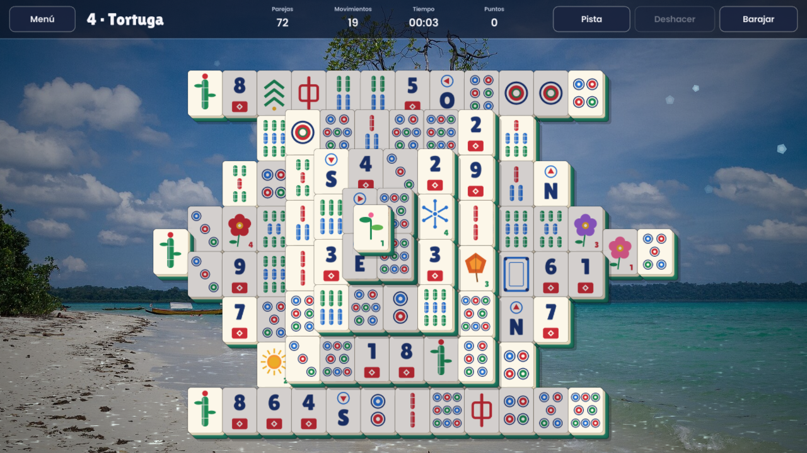
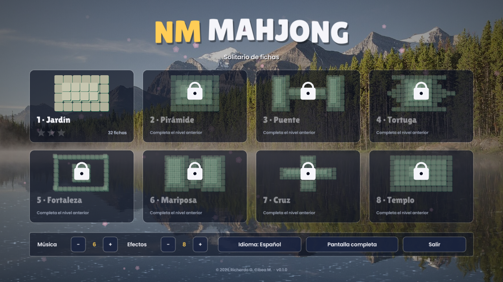
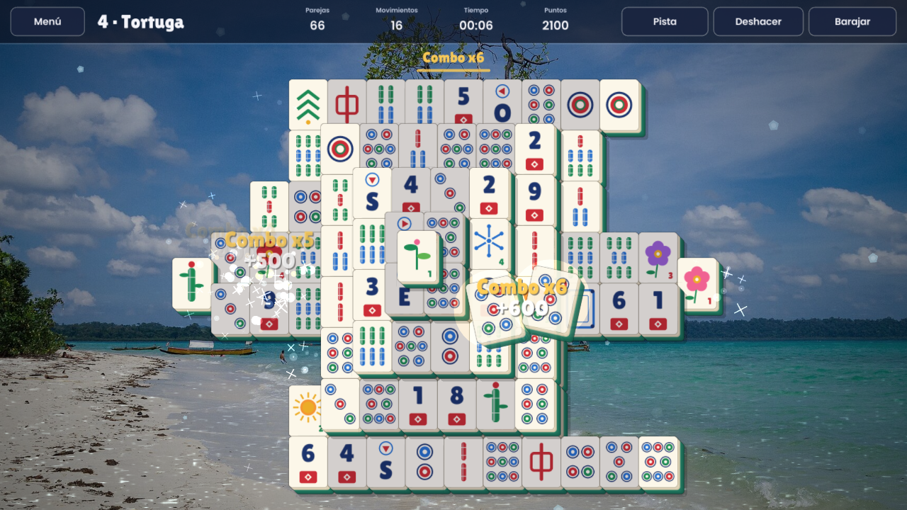
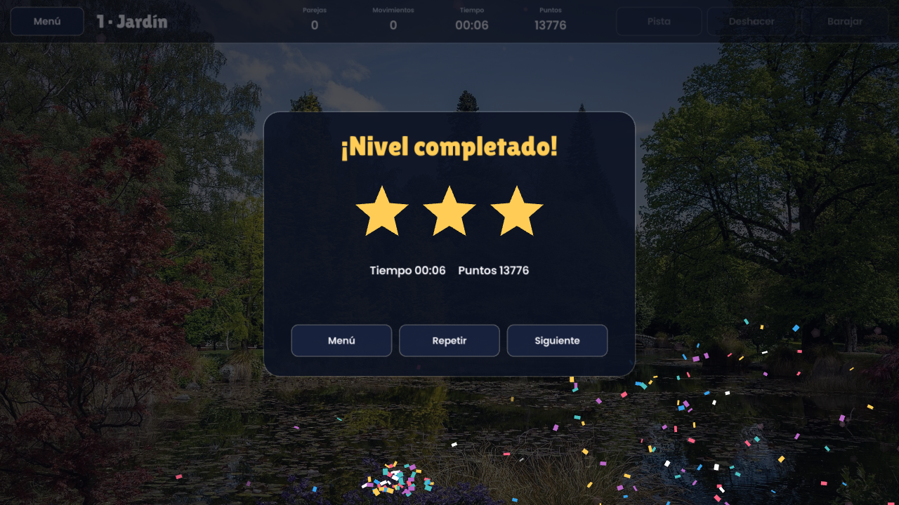

# NM Mahjong

Un solitario de mahjong para relajarse: empareja fichas, despeja el tablero y
avanza por ocho niveles con su propio paisaje y su propia música.

*[English below](#english)*

## Qué ofrece

- **Ocho niveles** con formas distintas, del pequeño *Jardín* a los 144
  fichas de *Tortuga* y *Templo*. Cada nivel se desbloquea al completar el
  anterior.
- **Siempre tiene solución.** Las fichas se reparten de forma que el tablero
  pueda despejarse entero.
- **Paisajes reales animados**: cada nivel tiene su fotografía —lagos, dunas,
  playas, auroras, templos— con movimiento lento, bruma y destellos en el agua.
- **Música ambiental** que nunca se repite igual y cambia de carácter según el
  nivel.
- **Efectos**: destellos al emparejar, combos si encadenas parejas con
  rapidez y confeti al terminar.
- **Ayudas** cuando las necesites: pista, deshacer y barajar.
- **Hasta tres estrellas** por nivel y tu mejor tiempo guardado.
- **En español y en inglés**, se cambia desde el menú.
- **Se actualiza solo**: cuando hay una versión nueva, el menú te avisa y la
  instala con un clic.

| Menú | Combos | Nivel completado |
|---|---|---|
|  |  |  |

## Cómo se juega

1. Pulsa una ficha **libre** y después otra igual para retirarlas las dos.
2. Una ficha está libre cuando no tiene ninguna encima y tiene despejado el
   lado izquierdo o el derecho. Las que no se pueden usar se ven algo más
   apagadas.
3. Las **flores** emparejan con cualquier otra flor, y las **estaciones** con
   cualquier otra estación.
4. Ganas al retirar todas las fichas.

Si te quedas sin movimientos puedes barajar las fichas que quedan o deshacer
tus últimas jugadas. Cuantas menos ayudas uses, más estrellas consigues.

## Descarga e instalación

Las versiones se publican en la sección **Releases** de este repositorio.

**Windows (64 bits).** Descarga el archivo `.zip`, descomprímelo y abre
`NMMahjong.exe`. La primera vez Windows puede mostrar un aviso de SmartScreen:
pulsa *Más información* y luego *Ejecutar de todas formas*.

**macOS (Apple Silicon: M1 o posterior).** Descarga el archivo `.dmg`, ábrelo
y arrastra *NMMahjong* a *Aplicaciones*. La primera vez haz clic derecho sobre
la aplicación y elige *Abrir*; si macOS la bloquea, permítela desde *Ajustes
del Sistema → Privacidad y seguridad*.

¿Quieres compilarlo tú? Las instrucciones están en
[docs/COMPILAR.md](docs/COMPILAR.md).

## Créditos y licencia

Creado por **Richardo G. Cibea M.** © 2026. Todos los derechos reservados.

NM Mahjong es software propietario: puedes descargarlo y jugar, pero no
copiarlo, modificarlo ni redistribuirlo. Las condiciones completas están en
[LICENSE](LICENSE) y los componentes de terceros que utiliza —incluidos los autores de las
fotografías de fondo—, en [THIRD-PARTY-NOTICES.md](THIRD-PARTY-NOTICES.md).

---

# NM Mahjong (English)

A mahjong solitaire to unwind with: match tiles, clear the board and work your
way through eight levels, each with its own scenery and music.

## What you get

- **Eight levels** with different shapes, from the small *Garden* to the 144
  tiles of *Turtle* and *Temple*. Clearing a level unlocks the next one.
- **Always solvable.** Tiles are dealt so the whole board can be cleared.
- **Real, animated scenery**: every level has its own photograph (lakes,
  dunes, beaches, auroras, temples) with slow motion, mist and water sparkles.
- **Ambient music** that never plays the same way twice and changes mood with
  the level.
- **Effects**: sparkles on every match, combos when you chain pairs quickly
  and confetti when you finish.
- **Help** when you need it: hint, undo and shuffle.
- **Up to three stars** per level, and your best time is saved.
- **English and Spanish**, switchable from the menu.
- **Updates itself**: when a new version is out, the menu tells you and
  installs it with one click.

## How to play

1. Click a **free** tile and then a matching one to remove both.
2. A tile is free when nothing sits on top of it and its left or right side is
   open. Tiles you cannot use yet look slightly dimmed.
3. Any **flower** matches any other flower, and any **season** matches any
   other season.
4. You win by removing every tile.

If you run out of moves you can shuffle the remaining tiles or undo your last
moves. The less help you use, the more stars you earn.

## Download and install

Versions are published in the **Releases** section of this repository.

**Windows (64-bit).** Download the `.zip` file, extract it and open
`NMMahjong.exe`. The first time, Windows may show a SmartScreen warning: click
*More info* and then *Run anyway*.

**macOS (Apple Silicon: M1 or later).** Download the `.dmg` file, open it and
drag *NMMahjong* into *Applications*. The first time, right-click the app and
choose *Open*; if macOS blocks it, allow it in *System Settings → Privacy &
Security*.

## Credits and license

Created by **Richardo G. Cibea M.** © 2026. All rights reserved.

NM Mahjong is proprietary software: you may download and play it, but not copy,
modify or redistribute it. Full terms are in [LICENSE](LICENSE); the
third-party components it uses, including the background photographers, are
credited in [THIRD-PARTY-NOTICES.md](THIRD-PARTY-NOTICES.md).
